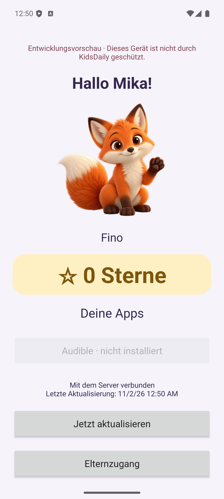
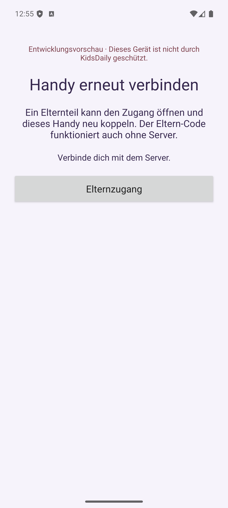

# Android-Elternzugang: Proof of Done

Am 2. November 2026 mit einem eigenen API-35-/Android-15-ARM64-Emulator, echtem Next.js-Produktionsserver und einer getrennten migrierten PostgreSQL-16-Datenbank `kidsdaily_maintenance_test` geprüft. Ausschließlich fiktive Daten. Der bereits vom Benutzer geöffnete Emulator und seine Daten wurden für diese Tests nicht verwendet.

Die Elternverwaltung erstellt eine separate, einmalige Bestätigung für das gekoppelte Android-Gerät. Auf dem Handy wurde damit ein eigener lokaler Eltern-Code eingerichtet. Nach Rückkehr in den Kindermodus verlangt der Elternbereich diesen Code erneut. Ein normaler Gerätecode/Kindertoken ersetzt die Bestätigung nicht.

Nach serverseitigem Widerruf des Kindertokens wurde der Testserver gestoppt und der App-Prozess neu gestartet. Der lokale Code öffnete die Wartung weiterhin ohne Server. Die Eltern-Datei blieb separat Keystore-verschlüsselt erhalten; der lokale Code lag darin nicht im Klartext. Systemeinstellungen wurden über die geschützte Wartungsaktion geöffnet; beim Wechsel zurück in KidsDaily war eine neue Eltern-Anmeldung erforderlich.

Die Eltern-Dialoge sind mit `FLAG_SECURE` absichtlich vor Screenshots geschützt. Deshalb zeigen die Screenshots die tatsächlichen Einstiegspunkte. Die geschützten Dialogabläufe wurden direkt im Emulator über die native UI bedient und geprüft; weder Eingaben noch Codes werden als Screenshot oder UI-Dump eingecheckt.

Automatische Prüfungen:

- 24 Android-JVM-Tests, einschließlich gerätegebundener Bestätigung ohne Kindertoken, echter Loopback-HTTP-Requests, Offline-Anmeldung, fünf Minuten Frist, Hintergrundwechsel während Hash-Berechnung, Neustart/Boot-Wechsel, persistenter Fehlversuche, Uhrzeitänderung, beschädigtem Speicher und Repository-Prüfung vor Trennen/Koppeln.
- Debug und Release gebaut, beide Android-Lint-Läufe erfolgreich.
- Web-Lint, Typprüfung und 18 Tests erfolgreich; Produktionsbuild erfolgreich.
- 21 Datenbank-Integrationstests gegen die neue Migration erfolgreich: Haushalts-/Gerätegrenzen, Ablauf, alte ersetzte Codes, genau ein erfolgreicher paralleler Verbrauch und Eltern-Bestätigung nach Kindertoken-Widerruf.
- Echter HTTP-Smoke-Test erfolgreich: Elternsitzung zur Ausstellung, Ablehnung von Kindertokens, einmalige gerätegebundene native Bestätigung ohne Cookies, unveränderte lesende Kindertoken-Rechte und Widerruf.

Wartungsfreigaben werden ausschließlich im Arbeitsspeicher gehalten; Fehlversuche dagegen vor der Hash-Prüfung dauerhaft reserviert. Die maximale Wartezeit beträgt 30 Minuten. Geräte-Neustarts können sie nicht verkürzen; eine laufende Sperrfrist beginnt im neuen Boot erneut vollständig. PBKDF2-SHA256 wird mit 600.000 Iterationen und zufälligem Salz verwendet; zusätzlicher Keystore-Schutz und getrennte Schlüssel für Kinder- und Elternzugang.

Keine Device-Owner-Provisionierung, kein Lock Task und keine Android-System-/Kamerasperren in diesem Schritt. Kein physischer Xiaomi-/LineageOS-/HyperOS-Nachweis. Die Vorschau schützt die Verwaltungsfunktionen innerhalb von KidsDaily; die Integration mit echten Sperren bleibt in Issue #2 offen.
