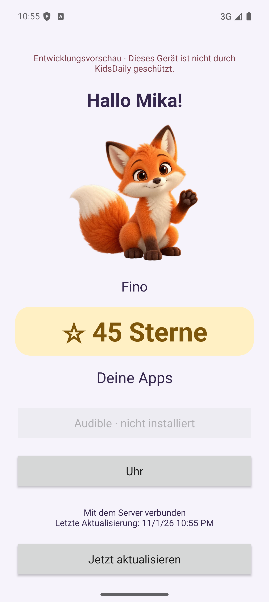
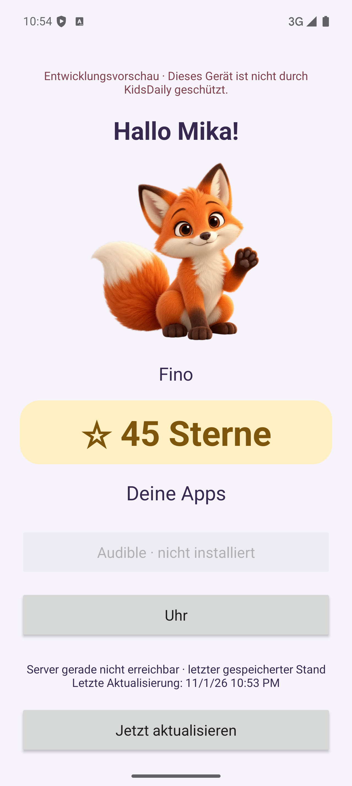

# Native Kopplung: Proof of Done

Geprüft am 1. November 2026: eigener Android-15-/API-35-ARM64-Emulator, getrennte PostgreSQL-16-Datenbank `kidsdaily_android_test` und echter Next.js-Produktionsserver. Ausschließlich fiktive Familie; kein Familienhandy provisioniert. Dies belegt die Client-Verbindung, keine Android-Gerätesperre.

Der Sternestand stieg nach einem echten Aufgabenabschluss über den Wandgeräte-Zugang von 35 auf 45. Die im Elternbereich freigegebene, installierte Uhr öffnete sich aus der App; fehlendes Audible blieb deaktiviert. Nach Entfernen der Uhr-Freigabe und erfolgreicher Synchronisierung verschwand sie aus der Liste.

Der Testserver wurde gestoppt, anschließend der App-Prozess beendet und neu gestartet. Buddy, 45 Sterne und letzte Aktualisierung blieben erhalten; die App zeigte den Offlinezustand. Der gespeicherte Datensatz war verschlüsselt und enthielt weder Profilnamen noch Serveradresse im Klartext. Nach Wiederverbindung wurden die aktuellen Freigaben übernommen.

Ein serverseitiger Geräte-Widerruf führte zurück zur Kopplung und entfernte die lokale Token-/Cache-Datei. Nach erneuter Kopplung wurde die verschlüsselte Datei absichtlich beschädigt: Der nächste Prozessstart verlangte wieder eine Kopplung und zeigte keinen alten Kinderstand. Die Code-Eingabe ist mit `FLAG_SECURE` geschützt und wird nicht als Screenshot aufgenommen.

Automatische Prüfung:

- `./gradlew testDebugUnitTest assembleDebug lintDebug assembleRelease lintRelease`: 15 Tests erfolgreich, beide APK-Varianten gebaut, keine Lint-Befunde.
- `npm run check`: Lint, Typprüfung und 18 Tests erfolgreich, einschließlich gemeinsamer Kotlin-/Zod-Vertragsdatei.
- `npm run build`: Produktionsbuild erfolgreich.
- `npm run test:integration`: 18 Tests gegen migrierte, getrennte Testdatenbank erfolgreich.
- `npm run test:http`: echte Registrierung/Verwaltung, getrennte Gerätezugänge, Live-Sterne, Schreibverbot für Android und Widerruf erfolgreich gegen den Test-Produktionsserver.
- Kompilierte Manifeste geprüft: Release verbietet Klartextverkehr; ausschließlich Debug erlaubt ihn zusätzlich zur Laufzeitprüfung privater IP-Adressen.

24-Stunden-Grenze, Uhrenrückstellung, Boot-Wechsel, falsche Geräte-/Kinder-ID, fehlerhafte/zu große Antworten, unzulässige Pakete/Berechtigungen, Redirects und gleichzeitige Trennung/Synchronisierung sind durch JVM-Tests abgedeckt. Android 13 sowie Xiaomi/LineageOS und Xiaomi/HyperOS wurden hier nicht physisch getestet. Device Owner, Lock Task, Systemleisten-/Kamerasperren, Boot-Wiederherstellung und Eltern-Recovery bleiben in [Issue #2](https://github.com/Florian-Cullmann/kidsdaily365/issues/2) offen.
