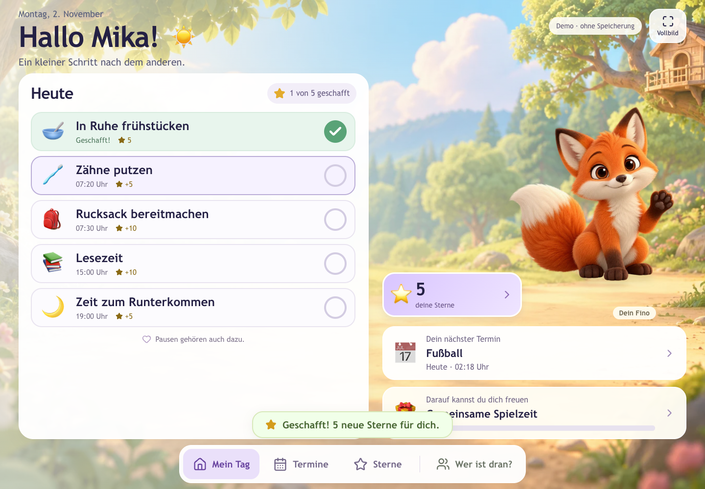
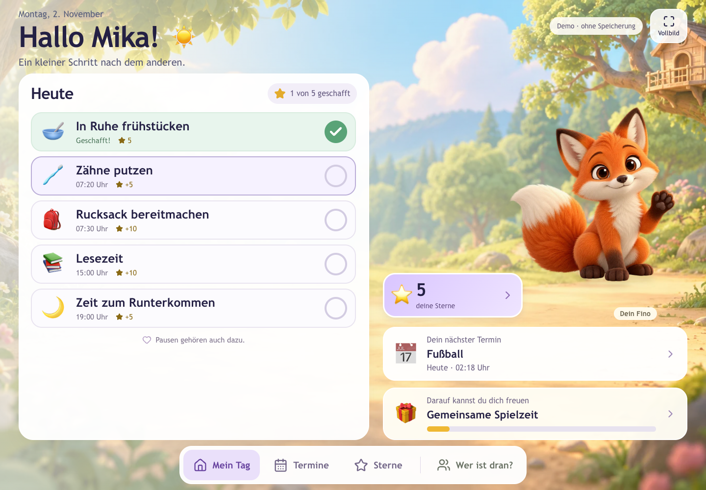

# Issue #7: Erfolgsmeldung nach fünf Sekunden

Geprüft am 2. November 2026 auf macOS/Chrome gegen den lokalen Produktionsbuild im Demo-Modus. Ausschließlich fiktive Profile. Keine neuen Projektabhängigkeiten; Playwright wurde für die Browserprüfung separat unter `/tmp` installiert.

`npm run check` (18 Tests, ESLint, TypeScript) und `npm run build` erfolgreich.

## Kontrollierte Browseruhr

Mit Playwright `page.clock.install()`, `pauseAt()` und `runFor()` geprüft:

- Frühstück erledigen, 3.000 ms weiter, Zähneputzen erledigen. Beide Aktionen erzeugen denselben Meldungstext mit fünf Sternen.
- Nach weiteren 2.000 ms bleibt die zweite Meldung sichtbar: Der erste Timer blendet sie nicht aus.
- Nach weiteren 2.999 ms noch sichtbar, nach einer weiteren Millisekunde leer.
- Beide Aufgaben bleiben erledigt, der Sternestand bleibt bei zehn.
- Eine neue Meldung auslösen, zu Leni wechseln: keine Meldung von Mika. Lenis eigene Meldung bleibt nach 4.000 ms sichtbar.
- Zu „Termine“ wechseln: Meldung leer. Zurück zu „Mein Tag“, erneut abschließen: Der alte Timer beendet die neue Meldung nicht vorzeitig.
- Vollbild-Fehler durch abgelehntes `requestFullscreen()` simulieren: Nach fünf Sekunden ist die Erfolgsmeldung leer, der Fehlerhinweis mit F11 weiterhin sichtbar.

Bei der Leerprüfung den DOM-Selektor `[role=status]` verwenden: Die bestehende CSS-Darstellung verbirgt die leere Statusfläche vor rollenbasierten Sichtbarkeitsabfragen.

## Tatsächliche Ansicht

Zusätzlich mit laufender Browseruhr aufgenommen: direkt nach dem Abhaken und nach 5,2 Sekunden. Fünf Sterne und die erledigte Aufgabe bleiben erhalten.

Keine Datenbank- oder Berechtigungsänderungen. Kein physischer Windows-Touchscreen- oder Screenreader-Test; die bestehende `aria-live="polite"`-Statusfläche bleibt erhalten.
